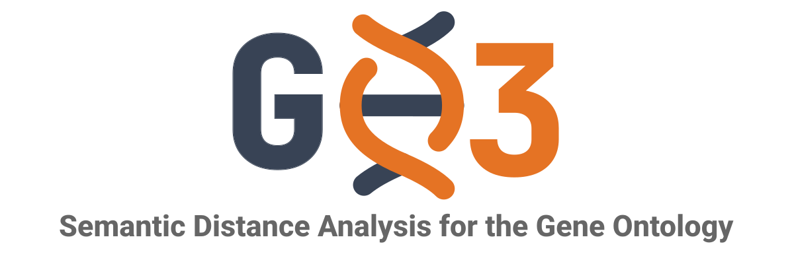
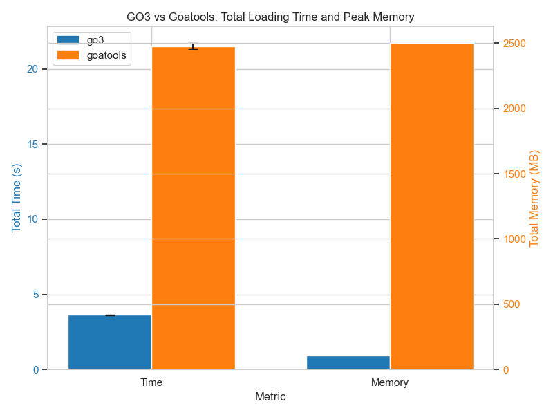

# GO3: Gene Ontology Semantic Similarity & Enrichment in Rust + Python



[](https://pypi.org/project/GO3/)
[](https://go3.readthedocs.io/en/latest/)
[](LICENSE)

**GO3** is a high-performance Python library powered by a **Rust core** (via PyO3 and Rayon) for Gene Ontology (GO) semantic similarity, annotation filtering, redundancy reduction, and Over-Representation Analysis (ORA).

Published in *SoftwareX*: [https://doi.org/10.1016/j.softx.2026.102755](https://www.sciencedirect.com/science/article/pii/S2352711026002475)

---

## Why GO3?

- **All-in-one GO toolkit**: Compute term, term-set, gene, and gene-set similarity, run GO enrichment (`go_enrichment`), condense redundant terms (`reduce_redundant_terms`), and build t-SNE/UMAP embeddings in a single library.
- **Native GAF 2.2 filtering & `.gz` support**: Load `.obo`/`.obo.gz` and `.gaf`/`.gaf.gz` directly, filtering by evidence codes, GO aspects, qualifiers, or obsolete terms at parse time in Rust.
- **Order-of-magnitude speed**: 3.6–12.5× faster initialization and 2–25× faster gene-level similarity than existing Python and R packages, with automatic multi-core parallelism.

---

## Installation

```bash
pip install go3
```

Optional visualization dependencies (`scikit-learn`, `umap-learn`, `matplotlib`):

```bash
pip install 'go3[viz]'
```

Requires **Python >= 3.7**. Pre-built wheels are provided for Linux, macOS, and Windows.

---

## Quick Start

```python
import go3

# 1. Load ontology (omit path to auto-download go-basic.obo; supports .obo and .obo.gz)
go3.load_go_terms("go-basic.obo")

# 2. Load GAF 2.2 annotations (supports .gaf and .gaf.gz) and compute Information Content (IC)
annots = go3.load_gaf("goa_human.gaf.gz")
counter = go3.build_term_counter(annots)

# 3. Term-to-term similarity
sim_term = go3.semantic_similarity("GO:0006397", "GO:0008380", "lin", counter)

# 4. Gene-to-gene similarity (BP, MF, or CC)
sim_gene = go3.compare_genes("TP53", "BRCA1", "BP", "lin", "bma", counter)

# 5. Gene-set similarity
sim_set = go3.compare_gene_sets(["TP53", "BRCA1", "ATM"], ["CASP8", "GSDME"], "BP", "lin", "bma", counter)

# 6. GO Over-Representation Enrichment (supports "bh", "scs" / g:SCS, and "bonferroni")
enriched = go3.go_enrichment(["PINK1", "PRKN", "PARK7", "SNCA", "LRRK2"], ontology="BP", method="scs")
for r in enriched[:3]:
    print(r.go_id, r.name, f"p_scs={r.p_scs:.2e}", r.study_genes)
```

---

## Core Workflows

### 1. Native GAF 2.2 Filtering & Inspection

Filter annotations during Rust parsing with `GAFParseOptions`. Each returned `GAFAnnotation` exposes all 17 GAF 2.2 columns:

```python
opts = go3.GAFParseOptions(
    exclude_evidence={"IEA"},       # or include_evidence={"EXP", "IDA", "IPI", "IMP", "IGI", "IEP"}
    include_aspects={"P", "F", "C"},
    exclude_qualifiers={"NOT"},
    allow_obsolete_terms=False,
    allow_nd_root_only=False,
)

annots = go3.load_gaf("goa_human.gaf.gz", options=opts)
counter = go3.build_term_counter(annots)

# Inspect any annotation record
a = annots[0]
print(a.db_object_symbol, a.go_id, a.evidence, a.taxon, a.assigned_by)
```

### 2. Ontology Navigation & Bidirectional Gene–Term Queries

```python
term = go3.get_term_by_id("GO:0006397")
print(term.name, term.namespace, term.depth, term.parents)

# Traverse ancestors and descendants (optionally including "part_of" edges)
anc = go3.ancestors("GO:0006397", relations=["part_of"])
desc = go3.descendants("GO:0006397", relations=["part_of"])
dca = go3.deepest_common_ancestor("GO:0006397", "GO:0008380")

# Query genes and terms directly
all_bp_genes = go3.list_genes(ontology="BP")
tp53_terms = go3.get_terms_for_gene("TP53", ontology="BP")
term_genes = go3.get_genes_for_term("GO:0006397", include_descendants=True)
```

### 3. GO Enrichment (ORA) & Semantic Redundancy Reduction

Run exact hypergeometric enrichment with true-path propagation and multiple-testing correction (`"bh"`, `"scs"` / `g:SCS`, `"bonferroni"`, or `"raw"`), then collapse redundant terms:

```python
import math

study = ["PINK1", "PRKN", "PARK7", "SNCA", "LRRK2"]
results = go3.go_enrichment(study, ontology="BP", alpha=0.05, min_overlap=2, method="scs")

# Prioritize most significant terms when reducing semantic redundancy
terms = [r.go_id for r in results]
scores = [-math.log10(max(r.p_scs, 1e-300)) for r in results]

rep_terms = go3.reduce_redundant_terms(terms, threshold=0.7, method="lin", counter=counter, scores=scores)
clusters = go3.cluster_go_terms(terms, threshold=0.7, method="lin", counter=counter, scores=scores)
```

### 4. Batch Comparisons, Gene Sets & Distance Matrices

All batch and matrix operations run in parallel across CPU cores via Rayon:

```python
# Batch term pairs & gene pairs
term_scores = go3.batch_similarity(["GO:0006397", "GO:0008150"], ["GO:0008380", "GO:0009987"], "lin", counter)
gene_scores = go3.compare_gene_pairs_batch([("TP53", "BRCA1"), ("EGFR", "AKT1")], "BP", "lin", "bma", counter)

# Compare gene sets via pairwise gene matrix ("bma", "max", "avg", "hausdorff")
# or via weighted GO-term profiles (also supports "simgic")
set_sim = go3.compare_gene_sets(["TP53", "BRCA1"], ["ATM", "CHEK2"], "BP", "lin", "bma", counter)
prof_sim = go3.compare_gene_set_profiles(["TP53", "BRCA1"], ["ATM", "CHEK2"], "BP", "lin", "simgic", counter)

# All-vs-all similarity and distance matrices
terms, t_sim = go3.term_similarity_matrix(["GO:0006397", "GO:0008380", "GO:0000398"], "lin", counter)
genes, g_dist = go3.gene_distance_matrix(["TP53", "BRCA1", "EGFR", "AKT1"], "BP", "lin", "bma", counter)
```

### 5. Embeddings & Visualization (`go3[viz]`)

```python
genes = ["TP53", "BRCA1", "EGFR", "AKT1", "CASP8"]

ordered, emb_t, fig_t, ax_t = go3.plot_tsne_genes(
    genes, "BP", "lin", "bma", counter, perplexity=2.0, random_state=42, annotate="auto"
)
ordered, emb_u, fig_u, ax_u = go3.plot_umap_genes(
    genes, "BP", "lin", "bma", counter, n_neighbors=3, random_state=42, annotate="auto"
)
```

---

## Similarity & Aggregation Reference

### Term-Level Similarity (`method` / `similarity`)

| Key | Method | Range | Category | Description |
|---|---|---|---|---|
| `lin` | Lin | `[0, 1]` | IC-based | Normalized MICA similarity: `2 * IC(MICA) / (IC(t1) + IC(t2))` |
| `resnik` | Resnik | `>= 0` | IC-based | Raw `IC(MICA)` of the Most Informative Common Ancestor |
| `simrel` | SimRel | `[0, 1]` | IC-based | Lin weighted by `1 - exp(-IC(MICA))` to penalize shallow ancestors |
| `jc` | Jiang-Conrath | `[0, 1]` | IC-based | Reciprocal of IC distance: `1 / (1 + IC(t1) + IC(t2) - 2*IC(MICA))` |
| `iccoef` | ICCoef | `[0, 1]` | IC-based | Ratio relative to minimum term IC |
| `wang` | Wang | `[0, 1]` | Topological | Graph topology path weights (`is_a=0.8`, `part_of=0.6`); no IC required |
| `graphic` | GraphIC | `[0, 1]` | Hybrid | IC combined with graph depth |
| `topoicsim` | TopoICSim | `[0, 1]` | Hybrid | Disjunctive common ancestor paths weighted by IC |

### Groupwise Aggregation (`groupwise`)

| Key | Strategy | Description |
|---|---|---|
| `bma` | Best-Match Average | Symmetrical average of best matches between two sets (recommended default) |
| `simgic` | SimGIC | IC-weighted Jaccard similarity over full ancestor sets |
| `max` | Maximum | Maximum similarity across all pairs |
| `avg` | Average | Mean similarity across all pairs |
| `hausdorff` | Hausdorff | Conservative worst-case best match (`min` of directional maxima) |

---

## Complete API Summary

| Category | Function / Class | Purpose |
|---|---|---|
| **Loading & IC** | `load_go_terms(path=None)` | Load OBO/OBO.gz ontology (auto-downloads `go-basic.obo` if omitted) |
| | `load_gaf(path, options=None)` | Parse GAF/GAF.gz file with optional `GAFParseOptions`; returns `list[GAFAnnotation]` |
| | `build_term_counter(annotations)` | Propagate counts up the GO DAG and compute per-term IC (`TermCounter`) |
| **Ontology & Queries** | `get_term_by_id(go_id)` | Return `PyGOTerm` metadata (`name`, `namespace`, `parents`, `children`, `depth`, etc.) |
| | `ancestors(go_id, relations=None)` | All ancestors of `go_id` (optionally including `["part_of"]`) |
| | `descendants(go_id, relations=None)` | All descendants of `go_id` (optionally including `["part_of"]`) |
| | `common_ancestor(id1, id2)` | Common ancestors of two GO terms |
| | `deepest_common_ancestor(id1, id2)` | Deepest common ancestor of two GO terms |
| | `list_genes(ontology=None)` | Sorted list of loaded gene symbols (optionally filtered by `"BP"`, `"MF"`, `"CC"`) |
| | `get_terms_for_gene(gene, ontology=None)` | GO terms annotated to a gene |
| | `get_genes_for_term(go_id, include_descendants=True)` | Genes annotated to a GO term (and its descendants by default) |
| **Term Similarity** | `term_ic(go_id, counter)` | Information Content of a GO term |
| | `semantic_similarity(id1, id2, method, counter)` | Similarity between two GO terms |
| | `batch_similarity(list1, list2, method, counter)` | Parallel similarity for aligned lists of GO terms |
| | `term_similarity_matrix(terms, method="lin", counter=None)` | All-vs-all similarity matrix for a list of GO terms |
| | `term_distance_matrix(terms, method="lin", counter=None, ...)` | All-vs-all distance matrix for a list of GO terms |
| | `reduce_redundant_terms(terms, threshold=0.7, ...)` | Keep one representative GO term per semantic cluster |
| | `cluster_go_terms(terms, threshold=0.7, ...)` | Group GO terms into `{representative_id: [member_ids]}` clusters |
| | `termset_similarity(terms1, terms2, method, groupwise, counter)` | Similarity between two sets of GO terms |
| **Gene Similarity** | `compare_genes(gene1, gene2, ontology, similarity, groupwise, counter)` | Similarity between two genes |
| | `compare_gene_pairs_batch(pairs, ontology, similarity, groupwise, counter)` | Parallel similarity for `(gene1, gene2)` pairs |
| | `compare_gene_sets(genes1, genes2, ...)` | Compare two gene lists by aggregating pairwise gene similarities |
| | `compare_gene_set_pairs_batch(pairs, ...)` | Parallel similarity for pairs of gene lists |
| | `compare_gene_set_profiles(genes1, genes2, ...)` | Compare two gene lists via weighted GO-term profiles (supports `simgic`) |
| **Enrichment (ORA)** | `go_enrichment(study_genes, ..., method="bh")` | Hypergeometric ORA with `"bh"`, `"scs"` (`g:SCS`), `"bonferroni"`, or `"raw"` |
| **Distances & Viz** | `gene_distance_matrix(genes, ...)` | Symmetric distance matrix across genes |
| | `gene_set_distance_matrix(gene_sets, ...)` | Symmetric distance matrix across named gene sets |
| | `tsne_genes(...)` / `umap_genes(...)` | 2D embeddings from gene semantic distances |
| | `plot_tsne_genes(...)` / `plot_umap_genes(...)` / `plot_embedding(...)` | Matplotlib scatter plots for embeddings |
| **Runtime** | `set_num_threads(n)` | Configure Rayon thread pool size (`0` = all cores) |

---

## Performance Benchmarks

Benchmarked on the human GO corpus (`goa_human.gaf`, Biological Process, Lin + BMA, Apple M3 Pro) against **GOATOOLS**, **FastSemSim**, **GOSemSim**, **simona**, and **TaxaGO**:

| Workload | Fastest Alternative | GO3 Speedup |
|---|---|---|
| Loading + IC calculation | FastSemSim (5.44 s) | **3.6–12.5× faster** |
| Batch term similarity (5,050 pairs) | FastSemSim (10.4 ms) | **4–24× faster** than Python tools; **>6,000× faster** than R tools |
| Batch gene similarity (100 pairs) | FastSemSim (2.39 s) | **2–25× faster** than Python/R libraries |



Full benchmark details and cross-tool validation are available in the [Documentation](https://go3.readthedocs.io/en/latest/benchmarks.html) and [`scripts/Supplementary Notebook S2.ipynb`](scripts/Supplementary%20Notebook%20S2.ipynb).

---

## Citation

```bibtex
@article{go3,
  title   = {GO3: A fast and lightweight library for semantic similarity of GO terms and genes},
  author  = {Jose L. Mellina-Andreu and Alejandro Cisterna-Garcia and Juan A. Botia},
  journal = {SoftwareX},
  volume  = {35},
  pages   = {102755},
  year    = {2026},
  issn    = {2352-7110},
  doi     = {https://doi.org/10.1016/j.softx.2026.102755},
  url     = {https://www.sciencedirect.com/science/article/pii/S2352711026002475}
}
```

## License

MIT License — see [LICENSE](LICENSE).
